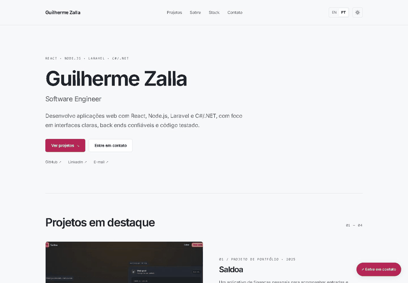
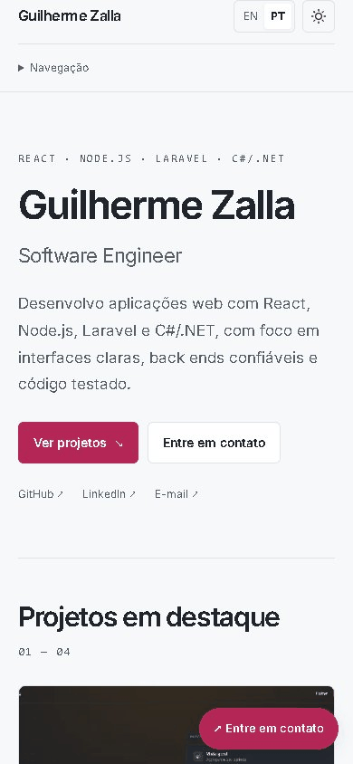
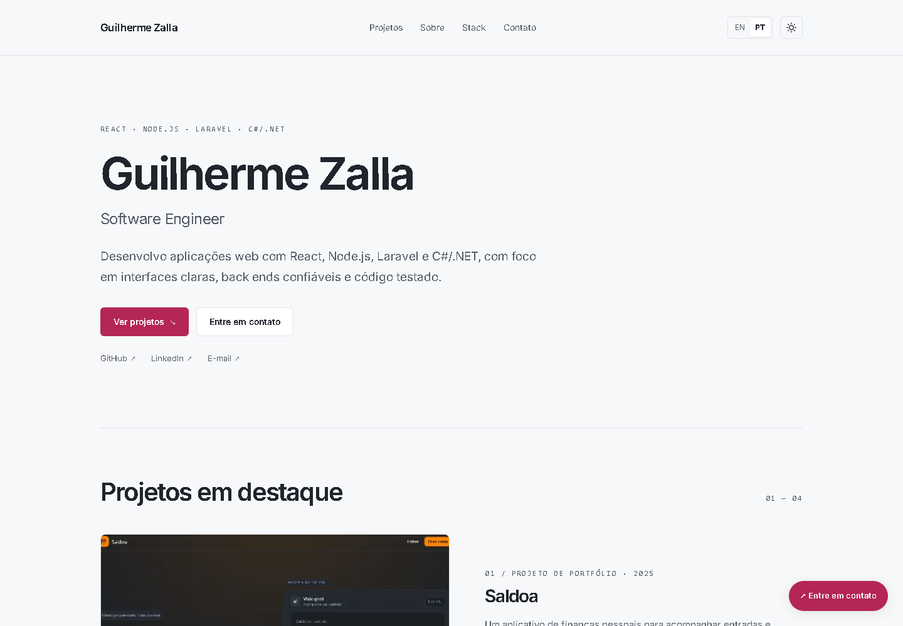
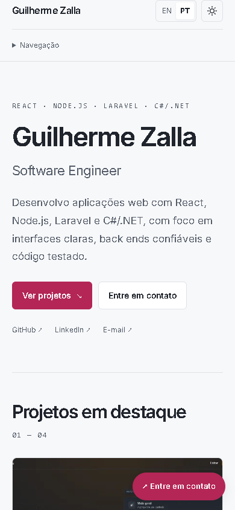

# Guilherme Zalla — Portfólio

Portfólio pessoal de Guilherme Zalla, Software Engineer. Apresenta projetos de aplicações web, estudos de caso, tecnologias, currículo e formas de contato em uma interface responsiva, com português/inglês e temas claro, escuro e automático.

O projeto começou com Create React App em 2022 e foi atualizado para React + Vite. A aplicação é estática: navegação, preferências e conteúdo funcionam no navegador, sem servidor de aplicação ou banco de dados. Está preparada para publicação no GitHub Pages em `https://guilhermezalla.github.io/`.

Código sob [licença MIT](LICENSE). A fonte Inter é servida localmente, com sua [licença OFL](public/fonts/Inter-LICENSE.txt). As capturas mostram os projetos do autor e preservam as imagens e marcas presentes em cada projeto.

## Demonstrações

Gravações reais do build local de produção, feitas com Playwright e Microsoft Edge. Os GIFs abaixo pertencem à documentação; as imagens exibidas dentro do portfólio são estáticas. Nenhuma demonstração envia e-mails ou mensagens para os contatos apresentados.

### Navegação pela Home

Hero, projetos em destaque, sobre, tecnologias e contato, com as animações e a rolagem da interface.



### Estudo de caso

Abertura do Saldoa a partir da Home, imagem do projeto, problema, decisões técnicas, desafios, resultado e retorno aos projetos.


### Idiomas, temas e contato

Troca entre inglês e português, seleção dos temas claro/escuro e abertura do painel de contato flutuante.


### Portfólio no celular

Menu móvel, projetos, estudo de caso e contato em uma tela de 390 px de largura.



## Screenshots

Capturas reais da versão atual em português, com desktop em **1440 × 1000** e celular em **390 × 844**. As versões completas incluem toda a altura da página. Os cartões e as imagens dos estudos de caso preenchem a moldura; o link “Abrir captura completa” permite consultar a imagem original do projeto.





| Tela | Desktop | Celular |
| --- | --- | --- |
| Home — claro | [Captura](docs/screenshots/home-desktop.png) · [Página completa](docs/screenshots/home-desktop-full.png) | [Captura](docs/screenshots/home-mobile.png) · [Página completa](docs/screenshots/home-mobile-full.png) |
| Home — escuro | [Captura](docs/screenshots/home-desktop-dark.png) · [Página completa](docs/screenshots/home-desktop-dark-full.png) | [Captura](docs/screenshots/home-mobile-dark.png) · [Página completa](docs/screenshots/home-mobile-dark-full.png) |
| Projetos em destaque | [Captura](docs/screenshots/projects-desktop.png) | [Captura](docs/screenshots/projects-mobile.png) |
| Estudo de caso — Saldoa | [Captura](docs/screenshots/case-saldoa-desktop.png) · [Página completa](docs/screenshots/case-saldoa-desktop-full.png) | [Captura](docs/screenshots/case-saldoa-mobile.png) · [Página completa](docs/screenshots/case-saldoa-mobile-full.png) |
| Estudo de caso — PixelRank | [Captura](docs/screenshots/case-pixelrank-desktop.png) · [Página completa](docs/screenshots/case-pixelrank-desktop-full.png) | [Captura](docs/screenshots/case-pixelrank-mobile.png) · [Página completa](docs/screenshots/case-pixelrank-mobile-full.png) |
| Estudo de caso — Sneakers Store | [Captura](docs/screenshots/case-sneakers-desktop.png) · [Página completa](docs/screenshots/case-sneakers-desktop-full.png) | [Captura](docs/screenshots/case-sneakers-mobile.png) · [Página completa](docs/screenshots/case-sneakers-mobile-full.png) |
| Estudo de caso — MoviesLib | [Captura](docs/screenshots/case-movieslib-desktop.png) · [Página completa](docs/screenshots/case-movieslib-desktop-full.png) | [Captura](docs/screenshots/case-movieslib-mobile.png) · [Página completa](docs/screenshots/case-movieslib-mobile-full.png) |
| Cabeçalho e contato aberto | [Captura](docs/screenshots/header-contact-desktop.png) | [Captura](docs/screenshots/header-contact-mobile.png) |

## Estrutura e stack

| Camada | Tecnologias usadas neste repositório |
| --- | --- |
| Interface | React 18, JavaScript/JSX e CSS |
| Navegação | React Router 6 com HashRouter |
| Idiomas | i18next e react-i18next, com traduções locais EN/PT |
| Desenvolvimento e build | Node.js, npm e Vite 8 |
| Testes de componentes | Vitest, Testing Library e jsdom |
| Verificação em navegador | Playwright, Microsoft Edge e axe-core |
| Desempenho | Lighthouse sobre o build local |
| Publicação | Arquivos estáticos de `dist/`, com `gh-pages` |

Laravel, C#/.NET e outras tecnologias citadas na apresentação fazem parte da experiência do autor e dos projetos apresentados. Este portfólio não executa um backend Laravel, Node.js ou .NET.

```text
src/
  components/site/   Cabeçalho, cartões, contato, rodapé e animações
  screens/           Home, estudos de caso e página não encontrada
  data/              Perfil, projetos e conteúdo dos estudos de caso
  hooks/             Tema, menus e metadados
  i18n/              Configuração e traduções EN/PT
  style/site.css     Estilos da interface atual
public/
  projects/          Capturas estáticas e prévias locais dos projetos
  fonts/             Inter e sua licença
docs/
  demo/              GIFs, manifesto e scripts de captura
  screenshots/       Capturas atuais para o README
  verification/      Evidências das verificações de navegador
  performance/       Relatórios locais do Lighthouse
  mockups/           Currículo utilizado no site
scripts/             Verificações e preparação de assets
```

O histórico de escopo e verificações fica em [docs/STATUS.md](docs/STATUS.md). Os arquivos do catálogo anterior permanecem como referência, sem substituir a seleção atual de projetos.

## Executar localmente

Requisitos: **Node.js 24.15+ na linha 24**, npm e um navegador. Esta entrega foi verificada com **Node.js 24.15.0**, compatível com as dependências atuais de build e testes. Não é necessário configurar `.env`, banco de dados, PHP ou serviço de e-mail.

### Projeto já configurado

Na pasta raiz do repositório, execute no PowerShell:

```powershell
npm.cmd run dev
```

Abra o endereço informado pelo Vite, normalmente `http://localhost:5173`. Mantenha o terminal aberto e pressione `Ctrl+C` para encerrar. Se a porta estiver ocupada, o Vite informa a porta alternativa.

### Primeira instalação

```powershell
npm.cmd ci
npm.cmd run dev
```

Em outros shells, os mesmos comandos podem ser executados com `npm`. No Windows, `npm.cmd` evita o bloqueio de `npm.ps1` pela política de execução do PowerShell.

### Conferir o build de produção

```powershell
npm.cmd run build
npm.cmd run preview
```

Abra o endereço informado pelo preview, normalmente `http://localhost:4173`. O build atual é gerado em **`dist/`**; a pasta `build/` pertence à versão antiga com CRA.

## Interface e navegação

A Home segue a ordem: apresentação, projetos em destaque, sobre, tecnologias e contato. Saldoa e PixelRank têm cartões maiores; Sneakers Store e MoviesLib aparecem em uma grade complementar.

Os quatro estudos de caso explicam problema, decisões técnicas, desafios e resultado, com índice navegável, stack, ano, repositório e captura do projeto. O conteúdo foi escrito a partir das descrições fornecidas e dos documentos dos próprios projetos, sem inventar métricas ou experiências pessoais. Fontes e limites estão em [docs/CASE_STUDIES.md](docs/CASE_STUDIES.md).

| Projeto | Ano | Página local |
| --- | --- | --- |
| Saldoa | 2025 | `/#/projects/saldoa` |
| PixelRank | 2026 | `/#/projects/pixelrank` |
| Sneakers Store | 2024 | `/#/projects/sneakers` |
| MoviesLib | 2026 | `/#/projects/movieslib` |

As rotas `/#/projects`, `/#/about`, `/#/stack` e `/#/contact` levam às seções da Home. Os antigos endereços `/#/portfolio/...` continuam levando aos projetos. O uso de hash permite abrir e atualizar uma página interna em uma hospedagem estática sem regras de reescrita no servidor.

## Idiomas, temas e acessibilidade

- **Idiomas:** inglês inicial e português pelo seletor EN/PT. A escolha fica em `localStorage`, com os textos dos projetos e estudos traduzidos e o atributo `lang` atualizado.
- **Temas:** sistema, claro e escuro. A escolha é persistida; no modo sistema, o site acompanha a preferência do dispositivo. Um script inicial aplica o tema antes da renderização do React.
- **Navegação:** link para pular ao conteúdo, foco visível, destinos de seção com foco, menu móvel e menus que fecham por Escape ou clique externo.
- **Movimento:** entrada discreta do hero, revelação única de seções e pequenas transições. `prefers-reduced-motion` desativa animações e rolagem suave. Sem IntersectionObserver, o conteúdo continua visível.
- **Imagens:** arquivos WebP locais, prévias menores na Home, dimensões declaradas, texto alternativo e carregamento adiado onde apropriado. O GIF original do Saldoa foi convertido em imagem estática.

## Conteúdo, currículo e contato

| O que alterar | Arquivo |
| --- | --- |
| Projetos, anos, links, descrições e stack de cada projeto | [src/data/projects.js](src/data/projects.js) |
| Perfil, foto, currículo, contatos e seleção curta de tecnologias | [src/data/profile.js](src/data/profile.js) |
| Textos dos estudos de caso | [src/data/caseStudies.js](src/data/caseStudies.js) |
| Textos gerais em português e inglês | [src/i18n/pt.json](src/i18n/pt.json) e [src/i18n/en.json](src/i18n/en.json) |
| Cores, tipografia e layout | [src/style/site.css](src/style/site.css) |

A foto atual é colorida e local. O currículo é importado de `docs/curriculo/Curriculo_Guilherme_Zalla_PT-BR.pdf` para o build. A pasta `docs/curriculo` contém somente quatro arquivos atuais: português e inglês, cada um em PDF e DOCX, com layout em duas colunas, lateral azul e sem foto. E-mail, LinkedIn e WhatsApp são links para os canais do autor; o site não recebe nem armazena mensagens. Next Game e Nova Geração ficam em `src/data/archived-projects.js` para possível revisão futura.

## Fluxo de demonstração

1. Apresente a Home e a proposta profissional.
2. Abra Saldoa ou PixelRank em “Ver estudo de caso” e mostre o problema, as decisões técnicas e as limitações.
3. Volte à Home e troque o idioma e o tema no cabeçalho.
4. Mostre a navegação no celular, o download do currículo e os canais de contato.

## Limites do projeto

- O conteúdo é mantido em arquivos do repositório; não há CMS, painel administrativo, autenticação ou banco de dados.
- Contato por links externos, sem formulário, envio próprio de e-mail ou armazenamento de mensagens.
- As páginas apresentam os projetos; suas APIs, bancos e demais serviços não são executados neste repositório. Links de demo são omitidos quando não há uma URL pública atual confirmada.
- As capturas são estáticas e podem ficar desatualizadas quando os projetos de origem mudarem.
- Os títulos e descrições mudam na navegação, mas a prévia social recebida sem JavaScript é a geral do portfólio. Não há renderização no servidor para gerar cards individuais por estudo.
- Os testes automatizados de acessibilidade e o Lighthouse não substituem avaliação humana nem garantem o mesmo resultado na hospedagem pública.

## Verificação

```powershell
npm.cmd test
npm.cmd run build
node scripts/verify-browser.mjs
```

Os **oito testes de componentes** cobrem seleção de projetos, contatos/currículo, idioma, tema, compatibilidade de rotas e abertura dos quatro estudos. Foram executados novamente para esta atualização, junto ao build de produção.

O script de navegador exige **Microsoft Edge instalado** (`channel: msedge`). Confere a Home em 360, 390, 768 e 1440 px nos dois idiomas e temas, além dos quatro estudos em 390/1440 px em EN/claro e PT/escuro. Inclui axe WCAG A/AA, URLs diretas, atualização da página, foco, menus, preferências, currículo e movimento reduzido. Usa um servidor temporário para `dist/`, sem publicar o site. Relatório: [docs/site-verification.json](docs/site-verification.json).

Para medir desempenho localmente:

```powershell
node scripts/measure-lighthouse.mjs
node scripts/measure-lighthouse.mjs --case=saldoa
```

Relatórios anteriores da etapa 3, **não medidos novamente nesta atualização documental**:

| Página | Desempenho mobile | Desempenho desktop | Acessibilidade / boas práticas / SEO |
| --- | --- | --- | --- |
| Home | 97 | 100 | 100 / 100 / 100 |
| Saldoa | 96 | 100 | 100 / 100 / 100 |

Fontes: [Home](docs/performance/summary.json) e [Saldoa](docs/performance/saldoa-summary.json). As medições usam o build local com throttling simulado; os resultados na hospedagem pública podem variar.

### Atualizar screenshots e GIFs

Além das dependências npm, a gravação exige Microsoft Edge, Python 3.10+ e Pillow. Pillow é usado apenas para montar os GIFs e pode ficar na pasta temporária ignorada, sem alterar as dependências da aplicação:

```powershell
python -m pip install --target .asset-work/python Pillow
npm.cmd run build
node docs/demo/record.mjs
```

O script gera 28 PNGs em `docs/screenshots/` e quatro GIFs em `docs/demo/`, a partir de ações reais no navegador. Os quadros intermediários ficam em `.asset-work/readme-capture/`, fora do versionamento. Os GIFs desktop têm 800 px de largura; o mobile preserva 390 px e é exibido menor no README. O [manifesto de captura](docs/demo/manifest.json) registra dimensões, quantidade de quadros e duração. Não usa dados de banco, não abre os links de contato e encerra seu navegador e servidor temporários ao concluir.

## Decisões técnicas

- **SPA estática:** o portfólio apresenta conteúdo e links, portanto não precisa manter um servidor de aplicação ou banco.
- **Vite no lugar do CRA:** build atual em `dist/`, com React preservado e scripts simples de desenvolvimento, teste e preview.
- **HashRouter:** navegação interna compatível com GitHub Pages, incluindo abertura direta e atualização dos estudos de caso.
- **Conteúdo separado dos componentes:** perfil, projetos e estudos ficam em arquivos próprios; textos gerais usam traduções locais.
- **Preferências locais:** idioma e tema usam `localStorage`, sem exigir cadastro. O tema do sistema continua acompanhado quando esse modo está selecionado.
- **Assets locais:** fonte, foto, currículo e capturas não dependem de URLs remotas para aparecer. Prévia e captura maior têm usos separados.
- **Estudos no bundle principal:** evita uma etapa extra de carregamento do JavaScript ao abrir um estudo diretamente. A imagem desse estudo também é antecipada no HTML inicial.
- **Movimento e foco:** efeitos curtos respeitam movimento reduzido; a navegação considera teclado e foco ao mudar de seção.

## Publicação no GitHub Pages

O destino configurado é `https://guilhermezalla.github.io/`, na raiz do domínio, com `base: '/'` no Vite. O método de publicação usa a branch `gh-pages`:

```powershell
npm.cmd run deploy
```

Esse comando executa o build e publica **`dist/`** com o pacote `gh-pages`. O GitHub Pages está configurado para servir a raiz da branch `gh-pages`. A branch `main` mantém o código-fonte; a `gh-pages` recebe os arquivos compilados pelo comando de deploy. Não é necessário fazer merge entre essas branches nem publicar a pasta antiga `build/`.
